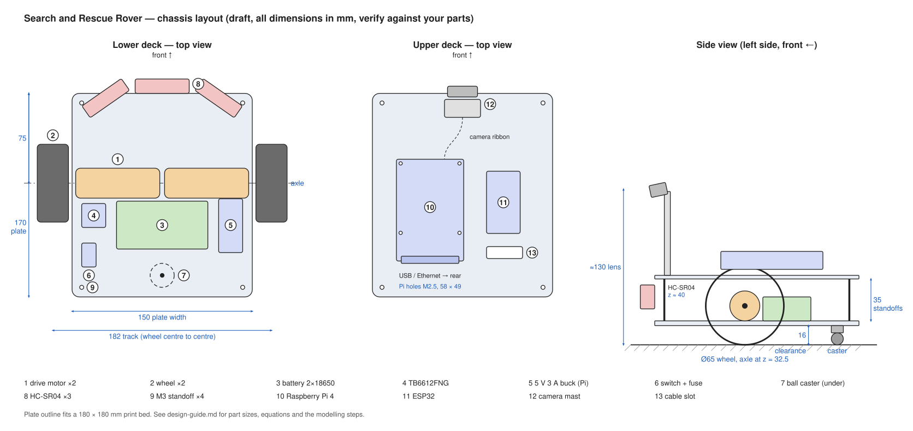

# Chassis design guide (Phase 1)



This is a starting layout and a set of design rules, not a finished model. I model the
chassis myself in Onshape / Fusion 360 from it. (Layout drawing and guide drafted with an
AI assistant — see build log.)

All sizes below are **typical values to check with calipers** once the parts arrive.
Put every measured number into the CAD as a named variable so the model updates when a
number changes.

## Design decisions

| Decision | Choice | Why |
| --- | --- | --- |
| Drive | 2 driven wheels + rear ball caster | Turns predictably, so wheel odometry works; simple maths |
| Layout | Two decks on 4 × M3 standoffs | Lower deck: power and motors (heavy, low). Upper deck: Pi, ESP32, camera |
| Axle position | 75 mm from the front, near the middle | Turns in place without the body sweeping a big circle |
| Battery | Just behind the axle, on the lower deck | Keeps the centre of mass low and over the drive wheels (traction) |
| Plate size | 150 × 170 mm | Fits a 180 × 180 mm print bed (e.g. Bambu A1 mini) |
| Sensors | 3 × HC-SR04 on one front bracket: centre forward, sides angled ~35° | Covers the front and both front corners |

## Parts and the dimensions that matter

| # | Part | Typical size (verify) | What to measure |
| --- | --- | --- | --- |
| 1 | JGA25-370 gear motor with hall encoder ×2 | Ø25 gearbox, 60–75 mm long incl. encoder, 4 mm D-shaft | Total length, shaft position (it can be off-centre from the motor body), mounting-hole pattern on the gearbox face |
| 2 | 65 mm wheel ×2 | Ø65, ~26 wide | Bore: many 65 mm wheels are made for TT motors (5.3 mm double-D) and need a **4 mm hub / coupler** for JGA25 shafts |
| 3 | 2 × 18650 holder | ~77 × 41 × 20 | Outline, wire exit side |
| 4 | TB6612FNG breakout | ~20 × 20 | Mounting holes (many have none: mount on perfboard) |
| 5 | 5 V 3 A buck converter | ~45 × 20 | Holes, height of the inductor |
| 6 | Switch + inline fuse | — | Panel-cut size for the switch |
| 7 | Ball caster | Height varies by model | Height from floor to mounting face (must match below) |
| 8 | HC-SR04 ×3 | 45 × 20 board, Ø16 transducers | Hole positions, transducer spacing |
| 9 | M3 standoffs ×4 | 35 mm | — |
| 10 | Raspberry Pi 4 | 85 × 56 board, M2.5 holes on a 58 × 49 rectangle, 3.5 from the edges | (These are official numbers) |
| 11 | ESP32 DevKit | ~52 × 28 | Board version: DevKitC vs. 30-pin clones differ; many have no holes |
| 12 | Pi Camera (v2) | 25 × 24, M2 holes 21 × 12.5 | Ribbon length (standard 150 mm) |

## The equations that set the geometry

**1. Ground clearance (plate underside height).** With the motors lying on top of the lower
plate and the wheel on the motor shaft:

```
clearance = wheel radius − motor radius − bracket/cradle thickness under the motor − plate thickness
          = 32.5 − 12.5 − 0 − 4  = 16 mm
```

If your motor shaft is off-centre from the motor body, use the distance from the shaft to
the bottom of the motor instead of the motor radius.

**2. Caster height.** The caster must reach the floor exactly at that clearance, or the
robot tilts and a drive wheel can lose grip:

```
caster height (floor to mounting face) = clearance = 16 mm
```

Too short → add a printed spacer. Too tall → recess the caster mount into the plate.

**3. Track width (for odometry).** The distance between the wheel centres:

```
track = plate width + 2 × (wheel gap + wheel width / 2) = 150 + 2 × (3 + 13) = 182 mm
```

Measure the real value on the built robot (contact patch to contact patch) and put it in
`firmware/rover_mcu/config.h` as `WHEEL_BASE_M`. Odometry errors scale directly with
errors in this number and in the wheel diameter.

**4. Standoff length.** The upper deck must clear the tallest part on the lower deck:

```
standoff ≥ tallest lower-deck part − plate top + 5 mm
         = 45 (motor top: 20 + 25) − 20 + 5 ≈ 30 mm  → use 35 mm
```

**5. Stability.** The centre of mass must sit inside the triangle formed by the two wheel
contact points and the caster. Keep heavy parts (battery, motors) low and between the axle
and the caster. Check it after the first build: tip the robot gently forward and back —
it should rock back onto the caster, not onto its nose.

**6. Speed check.** Top speed = π × wheel diameter × wheel rpm / 60. A motor turning
185 rpm on a 65 mm wheel gives about 0.63 m/s, which is plenty indoors. Note that a motor
rated for 12 V turns slower on a 2S (7.4 V) pack.

## Modelling steps

1. **Set up variables** for every number above (plate size, wheel and motor sizes, axle
   position, clearance, standoff length, hole sizes).
2. **Lower plate:** sketch the 150 × 170 outline with rounded corners, extrude 4 mm.
   Add the 4 standoff holes (8 mm in from each edge) and the caster mount at 18 mm from the
   rear edge on the centre line.
3. **Motor cradles:** two U-shaped saddles that hold each motor on the plate top, with a
   strap or screw clamp. (Or buy the matching JGA25 L-brackets and model their hole
   pattern instead.) Leave room at the back for the encoder board and its wires.
4. **Battery holder pocket or clips**, switch cut-out, mounting holes for the driver and the
   buck converter, and a cable hole up to the upper deck.
5. **Front sensor bracket:** one printed part with three sockets for the HC-SR04s — centre
   facing forward, sides at about ±35° — holding the transducers around 40 mm above the
   floor. Keep the transducer faces clear of the plate edge.
6. **Upper plate:** same outline, 3 mm thick. Pi 4 hole pattern (M2.5, 58 × 49) with
   5 mm standoffs, ESP32 mount, cable slot, and the camera-mast mount at the front.
7. **Camera mast:** puts the lens about 130 mm above the floor, tilted 10–15° down. Make the
   tilt adjustable (a pivot screw) — you'll tune it in testing.
8. **Assemble in CAD** with simple models of every part (boxes and cylinders at the
   measured sizes) to check for collisions, cable routes and screwdriver access.

Stiffness tip: a 4 mm flat plate can flex under the motors. Add 2–3 mm ribs underneath
along the length, or a raised lip around the edge.

## Printing

| Setting | Suggestion |
| --- | --- |
| Material | PETG (tougher, handles warm motors) or PLA for the first test prints |
| Walls / perimeters | 3–4 |
| Infill | 25–40 % gyroid |
| M3 clearance hole | 3.3–3.4 mm |
| M2.5 clearance hole (Pi) | 2.8 mm |
| Heat-set inserts | Use the hole size from the insert's datasheet (often ~4.0–4.2 mm for M3) |
| Orientation | Plates flat; brackets oriented so layer lines don't run across load paths |

**Print a test coupon first:** a small strip with one of each hole size, a slice of the
motor cradle and the Pi hole pattern. It takes ~20 minutes and saves a full failed plate.
This is where the planned "2–3 attempts for tolerances" go.

## Iteration log (fill in per print)

| Print | Date | What changed | What fitted | What didn't | Fix for next print |
| --- | --- | --- | --- | --- | --- |
| Test coupon | | | | | |
| v1 | | | | | |
| v2 | | | | | |

Photograph each version next to the previous one — it's strong evidence of iteration for
the portfolio.
